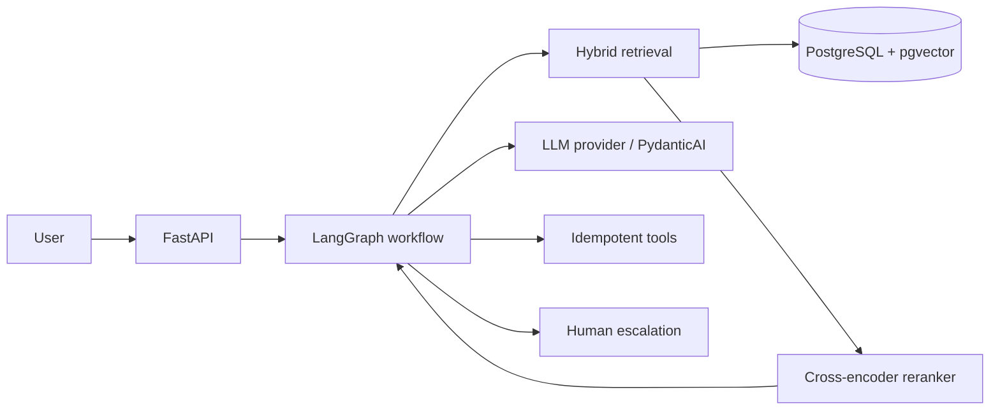

# Architecture

## Design decisions

- Tenant filtering is applied inside retrieval, not after retrieval.
- Document versions are explicit entities; current versions are prioritized in ranking.
- Hybrid retrieval uses semantic + PostgreSQL full-text candidates with Reciprocal Rank Fusion.
- Reranking is separated from first-stage retrieval so the three retrieval configurations can be evaluated independently.
- Tool writes use tenant-scoped idempotency keys.
